<p align="center">
  
</p>

<p align="center">
  <a href="https://docs.espressif.com/projects/esp-idf/en/v6.1/"></a>
  
  
  
  
  
  
  <a href="LICENSE"></a>
  <a href="https://x.com/astra442"></a>
</p>

---

## Overview

A native Discord Gateway and REST framework engineered to run **directly on the ESP32 microcontroller**.

No VPS. No Node.js runtime. No Python bridge. Pure bare-metal C99 communicating directly with Discord Gateway v10 and REST v10 over TLS 1.2 via `mbedTLS 4.1.0` (with dynamic buffers to conserve 20 KB DRAM).

* **Core Philosophy:** Parse minimally, copy minimally, store minimally, allocate zero, execute fast.
* **First Principle:** RAM is a design constraint, not available space.

---

## Engineering Highlights

* **Zero Dynamic Allocation Gateway & REST (`no-malloc`):** Streaming binary ETF (External Term Format) parser without syntax trees (zero AST). Requests and responses execute on fixed stack buffers and string views (`DiscordSlice`, zero memory duplication).
* **Deterministic Asynchronous Dispatching via Bounded Queues:**
  * **Interactions (`dc_intq`):** Bounded ring buffer with 4 slots (6,776 static bytes). The WebSocket read loop never blocks on command execution; handlers run on the dedicated `dc_bot` worker task.
  * **Fast Acknowledgment Pipeline (`dc_ackq`):** Dedicated task dispatching Discord interaction ACKs over a pre-warmed keep-alive HTTPS connection in `< 1s` (strictly respecting Discord's 3-second deadline).
* **NVS Hardware Guard for `IDENTIFY` Quota:** Discord enforces a strict hard quota of **1,000 `IDENTIFY` calls per 24 hours**, immediately invalidating bot tokens upon violation. Counter metrics and window timestamps persist to Flash NVS across hardware reboots, with absolute priority granted to session resumption (`RESUME`).
* **Deterministic Memory Footprint:** The framework's static RAM footprint measures exactly **7.80 KB** (`sizeof()`, compiled). The firmware runs stably 24/7 within the 85 to 142 KB of free DRAM after Wi-Fi and dual TLS context initialization.
* **100% Host Testable:** Native compilation and full test verification on developer machines without physical hardware. 23 test suites executed under `-Werror`, AddressSanitizer (ASan), and UndefinedBehaviorSanitizer (UBSan).

---

## Hardware Target

| Specification | Microcontroller Details |
|---|---|
| **Module** | **ESP32-WROOM-32D / 32U / 32UE** |
| **SoC** | ESP32-D0WD, dual-core Xtensa 32-bit LX6 clocked at 240 MHz |
| **SRAM** | 520 KB Total (**320 KB DRAM** + 200 KB IRAM) |
| **Boot DRAM** | **~275 KB** (leaving 85 to 142 KB available after Wi-Fi + 2 TLS contexts) |
| **Flash Memory** | 4 MB SPI Flash (**no external PSRAM required**) |
| **Toolchain** | ESP-IDF v6.1 (`mbedTLS 4.1.0`, FreeRTOS SMP) |

> [!NOTE]
> All ESP32-WROOM-32 variations share the identical ESP32-D0WD silicon die. The exact same firmware runs interchangeably on D, U, and UE revisions.

---

## System Architecture

<p align="center">
  
</p>

---

## Memory Budget & Runtime Limits

Certified compilation measurements (`sizeof`) verified under maximum stress:

| Component | Static RAM | Dynamic Allocation (Heap) | Flash Storage |
|---|---|---|---|
| **Full Framework Core** | **7.80 KB** | **0 B** | ~280 KB |
| **Interaction Ring (`dc_intq`)** | 6.77 KB (4 slots) | 0 B | - |
| **Acknowledgment Queue (`dc_ackq`)** | 1.84 KB (8 slots) | 0 B | - |
| **State Tracking (128 ranks, 32 spam, 16 tickets)** | 4.94 KB | 0 B | - |
| **Persistent Users (A/B Double-Buffer)** | - | 0 B | 16.0 KB (256 entries) |

### Capacity Limits & Degradation Policy

| Resource | Maximum Capacity | Saturation Behavior |
|---|---|---|
| **Ranked Users in RAM** | 128 users | Evicts oldest active entry (LRU recycling) |
| **Persistent Flash Records** | 256 records | Bounded store returns `FULL` error code |
| **Open Tickets** | 16 tickets | Recycles oldest record |
| **Active CAPTCHA Challenges** | 8 sessions | Immediate rejection of new session (`NULL`) |
| **Interaction Queue (`dc_intq`)** | 4 events | Drops incoming arrival and increments telemetry |

> [!TIP]
> For scaling ranked user capacity up to 1,024+ users, packed 12-byte struct optimizations, and Flash NVS persistence strategies, see [docs/13_scaling_and_persistence.md](docs/13_scaling_and_persistence.md).

---

## Security Architecture & Threat Model

Embedded security on the ESP32 operates across two independent boundaries: **remote network defense** and **physical hardware defense**.

### 1. Built-in Remote Defense (Firmware Level)

* **TLS 1.2 via mbedTLS 4.1.0:** All Gateway WebSocket (`wss://gateway.discord.gg`) and REST (`https://discord.com`) connections enforce TLS 1.2 with pinned root CAs (**DigiCert Global Root CA** and **GlobalSign Root CA**). Insecure plaintext HTTP/WS endpoints are rejected at compile-time and runtime.
* **Dynamic TLS Buffers:** Configured with `CONFIG_MBEDTLS_DYNAMIC_BUFFER=y`, saving ~20 KB DRAM per TLS context (~39 KB total across dual sockets). Dynamic buffers are mutually exclusive with TLS 1.3 in ESP-IDF, so TLS 1.2 is negotiated deterministically.
* **Anti-Redirect Token Protection:** The REST client strictly enforces `disable_auto_redirect = true`. Malicious HTTP 301/302 redirects are refused outright, preventing attacker servers from harvesting the bot's `Authorization` header.
* **Log Redaction:** Serial diagnostic output redacts bot tokens, only retaining non-sensitive truncated fingerprints for runtime diagnostics.
* **Zero-Malloc Memory Safety:** Stack-bound parsing and bounded FIFO rings protect against heap corruption, double-frees, and remote code execution vulnerabilities.

### 2. Physical & Hardware Security: You Decide the Configuration

> [!IMPORTANT]
> **You (the deployer) decide and configure the physical security level.**
> By default, development builds leave Flash Encryption and Secure Boot disabled in `sdkconfig.defaults`. This allows developers to flash binaries, debug over JTAG, and read serial logs without permanently burning irreversible hardware eFuses.

* **Remote vs. Physical Threat Model:** The firmware protects credentials and tokens against remote exfiltration over the network. However, on any standard ESP32 development board, someone with physical access to the board can dump the external SPI Flash chip over USB/UART (`esptool.py read_flash`) unless hardware encryption is turned on.
* **Enabling Production Flash & NVS Encryption:** For production deployments where physical board theft or probing is a threat, you must enable hardware-grade cryptographic protections via `idf.py menuconfig` before flashing:
  1. **Flash Encryption:** `Security features -> Enable hardware flash encryption on boot` (`CONFIG_SECURE_FLASH_ENC_ENABLED=y`)
  2. **Secure Boot v2:** `Security features -> Enable hardware Secure Boot in bootloader` (`CONFIG_SECURE_BOOT=y`)
  3. **Encrypted NVS:** Encrypt the NVS partition to protect bot tokens and Wi-Fi credentials at rest (`CONFIG_NVS_ENCRYPTION=y`).

---

## Privacy Policy & Member Data Governance

This framework adheres to strict **data minimization** principles:

| Data Category | Storage Tier | Lifetime / Retention | Content Description | PII? |
|---|---|---|---|---|
| **XP & Level Progression** | Flash (`DcStore`) | Persistent (A/B Flash) | 64-bit Discord Snowflake ID + XP uint32 + Level uint8 | **No** (numeric only) |
| **Open Tickets** | RAM (`DcBotState`) | Volatile (16 slots LRU) | Snowflake IDs (ticket ID, channel ID, user ID, message ID) | **No** (no message bodies) |
| **CAPTCHA Challenges** | RAM (`DcBotState`) | 5 minutes (8 slots max) | 6-character random alphanumeric verification string | **No** |
| **Anti-Spam State** | RAM (`DcBotState`) | Rolling 8-event window | 32-bit FNV message hashes (raw message text is never saved) | **No** |
| **Bot Token & Wi-Fi** | Flash (NVS) | Persistent | Bot token, Wi-Fi SSID & password | Device config only |

* **Zero Personal Information (PII):** The bot does **not** store message contents, user profile avatars, usernames, email addresses, or IP addresses.
* **Volatile Working Memory:** All tickets, CAPTCHA sessions, and spam anti-flood hashes exist exclusively in volatile RAM and are completely erased on device reboot.
* **Right to Erasure & Deletion:** User progression records in Flash can be deleted programmatically via the C API (`dc_store_delete(store, user_id)`) or by invoking moderation slash commands. The entire board can be wiped with `idf.py erase-flash`.

---

## Host Test Bench & Validation

The framework compiles and validates completely on development machines (Linux, macOS, WSL) without physical hardware:

```bash
# Run all 23 test suites
./tests/run_tests.sh
```

All 23 test suites run under `-Werror` with AddressSanitizer and UndefinedBehaviorSanitizer enabled:

* **Streaming ETF Decoder:** Stack depth limits, truncated payloads, resilience against malformed atoms.
* **Fuzz Testing:** 200,000 mutated inputs tested without crashes or memory leaks.
* **Soak Testing:** 7-day Monte-Carlo simulation across 6 degraded Wi-Fi network profiles.
* **Gateway State Machine:** Reconnection logic, heartbeat watchdog, resume vs. identify quotas.
* **Rate Limiter:** Token bucket validation (50 req/s, 120 ev/min, Discord header parsing).
* **Bounded Queues:** Circular ring stability, overload shedding, natural 32-bit memory alignment.

---

## Quick Start

### 1. Credentials Configuration

Copy the example environment file and configure your credentials:

```bash
# Copy example environment configuration
cp .env.example .env
```

Set your Wi-Fi credentials, Discord Bot Token, and target Guild ID in `.env`. Firmware limits, queue sizes, and timeouts can be customized in [`bot_config.h`](components/bot_config/include/bot_config.h).

### 2. Build and Flash to ESP32

Prerequisite: [ESP-IDF v6.1](https://docs.espressif.com/projects/esp-idf/en/v6.1/).

```bash
# 1. Set ESP32 hardware target
idf.py set-target esp32

# 2. Build firmware binary
idf.py build

# 3. Flash firmware and open serial monitor (replace PORT with your serial device)
idf.py -p PORT flash monitor
```

---

## License

This project is licensed under the [MIT License](LICENSE).

---

<h3 align="center">Want to leave feedback?</h3>

<p align="center">
  <a href="https://peership.dev" target="_blank" rel="noopener noreferrer">
    
  </a>
</p>

<p align="center">
  <a href="https://x.com/astra442" target="_blank" rel="noopener noreferrer">
    
  </a>
</p>
